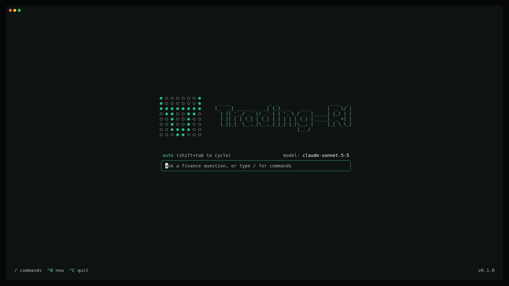
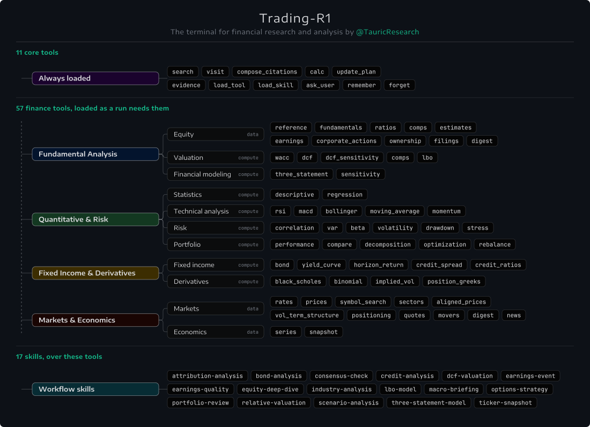

<p align="center">
  <a href="https://tauric.ai/">
    <picture>
      <source media="(prefers-color-scheme: dark)" srcset="assets/Trading-R1-dark.svg">
      
    </picture>
  </a>
</p>

<p align="center">
  <a href="https://arxiv.org/abs/2509.11420"></a>
  <a href="https://discord.com/invite/hk9PGKShPK"></a>
  <a href="https://x.com/TauricResearch"></a>
  <a href="https://github.com/TauricResearch/"></a>
  <a href="https://tauric.ai/"></a>
</p>

<p align="center">
  <a href="https://www.readme-i18n.com/TauricResearch/Trading-R1?lang=de">Deutsch</a> |
  <a href="https://www.readme-i18n.com/TauricResearch/Trading-R1?lang=es">Español</a> |
  <a href="https://www.readme-i18n.com/TauricResearch/Trading-R1?lang=fr">français</a> |
  <a href="https://www.readme-i18n.com/TauricResearch/Trading-R1?lang=ja">日本語</a> |
  <a href="https://www.readme-i18n.com/TauricResearch/Trading-R1?lang=ko">한국어</a> |
  <a href="https://www.readme-i18n.com/TauricResearch/Trading-R1?lang=pt">Português</a> |
  <a href="https://www.readme-i18n.com/TauricResearch/Trading-R1?lang=ru">Русский</a> |
  <a href="https://www.readme-i18n.com/TauricResearch/Trading-R1?lang=zh">中文</a>
</p>

<h2 align="center">Trading-R1: The terminal for financial research and analysis</h2>

<p align="center">
  
</p>

## Quick start

**1. Create a Tauric account and get an API key.** [Sign up](https://tauric.ai/signup), then
[create a key](https://tauric.ai/settings/api-keys).

**2. Install.**

```bash
curl -fsSL https://raw.githubusercontent.com/TauricResearch/Trading-R1/main/install.sh | sh
```

Or, with Python 3.12 or later and `bun`: `pip install trading-r1`.

**3. Add your key and start.**

```bash
export TAURIC_API_KEY=your-key
trading-r1
```

To store the key instead, run `trading-r1 secrets set TAURIC_API_KEY`, or press `/` in the app and
choose *API keys…*.

To uninstall, run `trading-r1 daemon uninstall` if you installed the service, then
`uv tool uninstall trading-r1` or `pip uninstall trading-r1`. Your data stays in `~/.trading-r1` and your reports folder.

## Choose a model

| Name | Model | Needs |
|---|---|---|
| `tauric` | `tauric` | `TAURIC_API_KEY` |
| `gpt` | `gpt-6.1-sol` | `OPENAI_API_KEY` |
| `anthropic` | `claude-sonnet-5-5` | `ANTHROPIC_API_KEY` |
| `gemini` | `gemini-3.8-flash` | `GEMINI_API_KEY` |
| `vllm` | `Qwen3.8-27B` | a vLLM server you run |

The app starts on the first you have set up, in the order OpenAI, Anthropic, Gemini, Tauric, vLLM.
Change it with *Model…* in the palette, or start on one with `trading-r1 --profile gpt`. To point
`vllm` at your server, see [Configuration](MANUAL.md#configuration).

## Use it

```bash
trading-r1                                          # open the terminal
trading-r1 "What's NVDA's last quarterly revenue?"  # and ask a first question
trading-r1 --mode analytical                        # start in a mode
```

| Key | Does |
|---|---|
| `/` or `^K` | Open the command palette |
| `shift+tab` | Cycle the mode |
| `^N` | Start new research |
| `esc` | Cancel the running turn, or close a dialog |
| `^C` | Quit |

| Mode | Focus |
|---|---|
| `auto` | Full toolkit; the agent decides |
| `research` | Web first, for deep research |
| `analytical` | Numbers first: data and valuation tools, with the web for context |

The palette lists every action: sessions, model and mode, reports, channels, scheduled reports,
tools and skills, API keys, the background service, Settings and Help.

## Architecture

<p align="center">
  
</p>

## Reports and sending

*Export report…* saves the last answer as a PDF and, by default, Markdown, in
`~/Documents/Trading-R1` or `~/Trading-R1`.

*Send report…* sends it to your channels, and sets one up if there is none.

| Channel | You give | Gets |
|---|---|---|
| `telegram` | a bot token from @BotFather, then write to the bot once and confirm the chat | text and the PDF |
| `email` | your address and an app password (presets: `gmail`, `icloud`, `yahoo`, `fastmail`) | text and the PDF |
| `folder` | a path | the report files |

To ask from your phone, set the Telegram channel's `reply` to `on`. While the backend is up, your
bot answers your messages with a short research run, and `/new` starts over.

## Scheduled reports

Jobs ask a question on a schedule and send the report to your channels. Use *Scheduled reports…* in
the palette, or:

```bash
trading-r1 jobs add --name "Morning brief" --every weekdays --time 08:00 --tz America/New_York \
    --prompt "What moved my watchlist overnight? NVDA, AAPL, MSFT." --deliver email,telegram
```

The commands and options for reports, channels and jobs are in the
[manual](MANUAL.md#reports-channels-and-jobs).

## Background service

Jobs and Telegram replies need a running backend, and the terminal's stops when you close it. To
keep one running, install a user service (Linux with systemd, macOS with launchd), from *Background
service…* in the palette or:

```bash
trading-r1 daemon install      # also: status, logs, start, stop, restart, uninstall
```

After you update, or change a key in your shell profile, run `trading-r1 daemon install` again.

## Manual

Commands, settings, session sync, your data and keys, configuration and adding a skill are in the
[user manual](MANUAL.md). To work on the code, see [CONTRIBUTING](CONTRIBUTING.md).

## Citation

```bibtex
@article{xiao2025trading,
  title={Trading-r1: Financial trading with llm reasoning via reinforcement learning},
  author={Xiao, Yijia and Sun, Edward and Chen, Tong and Wu, Fang and Luo, Di and Wang, Wei},
  journal={arXiv preprint arXiv:2509.11420},
  year={2025}
}
```

## Disclaimer

For research and education only, not investment advice.

## License

Apache-2.0. See [LICENSE](LICENSE).
